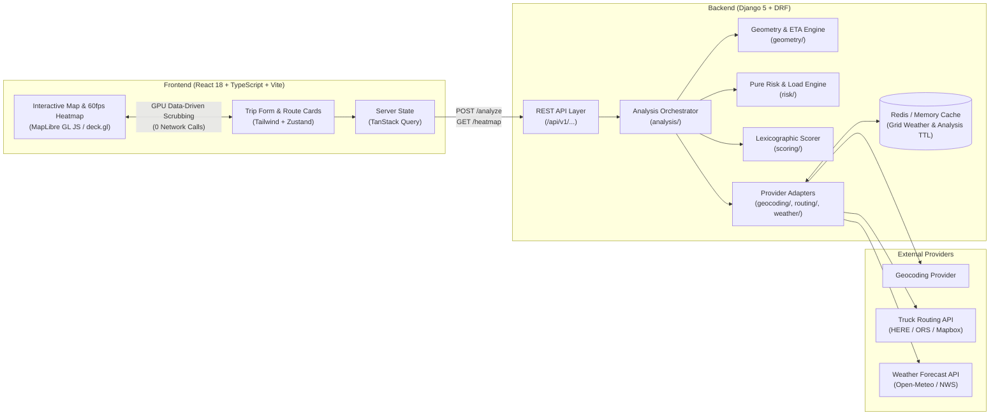

# Weather-Aware Truck Routing


A React + Django web application that helps truck drivers and dispatchers select the safest of up to three routes by combining **ETA-aligned weather forecasts**, **cargo load weight rules**, and **travel time**. Weather is sampled at user-configurable mileage checkpoints (10 / 25 / 50 mi) at the exact estimated time the truck arrives at each point, classified using deterministic risk and load-weight rules, and synthesized into an actionable route recommendation alongside a GPU-accelerated **0–48 hour corridor weather heatmap**.

---

## Live Links & Demo

| Resource | Link |
| --- | --- |
| **Live Application** | `https://<your-frontend-url>.vercel.app` *(update on deploy)* |
| **Demo Scenario (Severe Storm)** | `https://<your-frontend-url>.vercel.app/?demo=storm` *(triggers synthetic 30k/40k lb wind & No Travel rules immediately)* |
| **Backend OpenAPI / Swagger Docs** | `https://<your-backend-url>.onrender.com/api/schema/swagger-ui/` |
| **Loom Walkthrough (5–10 min)** | `https://www.loom.com/share/<your-loom-id>` *(update on record)* |

> **Note on Hosted Free Tiers:** The backend is health-pinged periodically to prevent cold starts, but if the instance has been idle, the initial request may take a few extra seconds to warm up.

---

## Key Features

- **Up to 3 Distinct Heavy-Vehicle Routes:** Requests truck-profile routes via a swappable provider adapter, de-duplicating routes that overlap by >90% and falling back to forced waypoints or secondary providers when needed.
- **ETA-Aligned Checkpoint Sampling:** Places checkpoints every `10`, `25`, or `50` miles (always including Origin and Destination). Interpolates per-section travel durations to compute exact checkpoint ETAs in each checkpoint's local timezone (handling timezone boundaries and DST).
- **Deterministic Weather Risk & Load Engine:** Evaluates sustained wind, rain rate, and snowfall rate independently, then applies strict cargo-weight escalation rules (`>30,000 lb` and `>40,000 lb`) with plain-language explanations at every checkpoint.
- **Lexicographic Route Recommendation:** Ranks clear routes deterministically by fewest `Severe` miles, fewest `High` miles, lowest distance-weighted average risk, and shortest duration—while flagging any route containing `No Travel` segments as **Blocked**.
- **60 FPS 0–48h Corridor Heatmap:** Precomputes a compact 49-hour risk grid across the buffered trip corridor (`~25 mi` buffer, capped at `~1,500` cells). Scrubbing the 0–48h timeline updates GPU data-driven styles on the client with **zero network requests**.
- **Synthetic Storm Demo Mode (`?demo=storm`):** Injects deterministic severe weather along the corridor so reviewers can test `Severe` and `No Travel` escalations and weight presets (`20k / 35k / 45k / 80k lb`) even on calm weather days.

---

## System Architecture



### Repository Structure

```text
.
├── backend/
│   ├── api/            # DRF serializers, views, throttling, OpenAPI schema
│   ├── analysis/       # Trip analysis & corridor heatmap orchestration
│   ├── geocoding/      # Provider-backed autocomplete & offline US place lookup
│   ├── routing/        # Truck routing adapters & >90% overlap de-duplication
│   ├── geometry/       # Polyline decoding, cumulative distance, ETA interpolation
│   ├── weather/        # 0.1° grid snapping, batch fetching, hourly interpolation
│   ├── risk/           # Pure, zero-I/O risk classification & load-weight rules
│   └── scoring/        # Segment attribution, average risk math & route ranking
├── frontend/
│   ├── src/
│   │   ├── components/ # Form, RouteCards, MapView, HeatmapSlider, CheckpointTable
│   │   ├── hooks/      # TanStack Query hooks & URL query-param sync
│   │   ├── store/      # Zustand UI state (selected route, slider hour, active layer)
│   │   └── types/      # Strict TypeScript API contracts
├── docs/               # Additional architecture notes & screenshots
├── docker-compose.yml  # Local full-stack orchestration (Django + Redis + Vite)
├── Makefile            # Developer convenience commands
└── Weather-Aware Truck Routing PRD.md
```

---

## Weather Risk & Load Rules

The risk engine (`backend/risk/`) is implemented as pure functions with zero I/O. Every checkpoint is scored from `Low (0)` to `No Travel (4)`.

### 1. Base Weather Thresholds

Each condition is classified independently; the checkpoint's base risk level is the **worst of the three**:

| Condition | Low (`0`) | Moderate (`1`) | High (`2`) | Severe (`3`) | No Travel (`4`) | Boundary Convention |
| --- | --- | --- | --- | --- | --- | --- |
| **Wind (mph)** *(sustained 10m)* | `< 25.0` | `25.0` to `< 35.0` | `35.0` to `< 45.0` | `45.0` to `< 55.0` | `>= 55.0` | Lower-inclusive (`[min, max)`) |
| **Rain (in/hr)** *(rain + showers)* | `< 0.10` | `0.10` to `0.25` | `> 0.25` to `0.50` | `> 0.50` to `1.00` | `> 1.00` | Upper-inclusive (`(min, max]`) |
| **Snow (in/hr)** *(snowfall depth)* | `< 0.5` | `0.5` to `1.0` | `> 1.0` to `2.0` | `> 2.0` to `3.0` | `> 3.0` | Upper-inclusive (`(min, max]`) |

### 2. Cargo Load Weight Escalation Rules

Load rules are applied **after** the base risk level is determined and can **only escalate** (never lower) the risk level:

1. **Rule (a) — Extreme Wind (`>= 55 mph`):** Always `No Travel` for **any** load weight.
2. **Rule (b) — High Wind + Heavy Load (`45.0` to `< 55.0 mph` & Load `> 30,000 lb`):** Escalates from `Severe` to `No Travel`.
3. **Rule (c) — Moderate-High Wind + Very Heavy Load (`35.0` to `< 45.0 mph` & Load `> 40,000 lb`):** Escalates from `High` to `Severe` (or remains higher if rain/snow already triggered `No Travel`).

#### Worked Examples

| Sustained Wind | Cargo Load | Resulting Level | Explanation |
| --- | --- | --- | --- |
| `56 mph` | `10,000 lb` | **No Travel** | Rule (a): Wind `>= 55 mph` is No Travel for any load |
| `47 mph` | `35,000 lb` | **No Travel** | Rule (b): Wind `45–54.9 mph` with load `> 30,000 lb` |
| `47 mph` | `28,000 lb` | **Severe** | Base level only (load `<= 30,000 lb`) |
| `38 mph` | `45,000 lb` | **Severe** | Rule (c): Wind `35–44.9 mph` with load `> 40,000 lb` escalates High to Severe |
| `38 mph` | `35,000 lb` | **High** | Base level only (load `<= 40,000 lb`) |

---

## Route Scoring & Recommendation Logic

### Segment Attribution & Average Risk
Each checkpoint owns the route distance from the midpoint of the previous checkpoint to the midpoint of the next checkpoint (so segment miles sum exactly to total route distance). A route's distance-weighted **Average Risk** is computed across all checkpoints with known weather:

$$\text{AverageRisk} = \frac{\sum_i \text{Miles}_i \cdot \text{Score}_i}{\sum_i \text{Miles}_i}$$

*(Segments with missing/unavailable weather are never silently scored as `Low`; they are excluded from the denominator and flagged separately as `unknown` miles with a UI warning banner.)*

### Deterministic Lexicographic Ranking
1. **Unblocked vs. Blocked:** Any route with `> 0` miles of `No Travel` is marked **Blocked** and ranked below all clear routes.
2. **Primary Sort (Clear Routes):**
   1. Fewest **Severe** miles *(compared at `0.1 mi` precision)*
   2. Fewest **High** miles *(compared at `0.1 mi` precision)*
   3. Lowest **Average Risk** score *(compared at `0.01` precision)*
   4. Shortest **Travel Duration**
3. **All-Blocked Fallback:** If every available route has `No Travel` segments, the UI displays a clear *"No safe route at this departure time"* alert and highlights the least-bad route (fewest `No Travel` miles, followed by the four criteria above).

---

## API Reference

Full interactive OpenAPI documentation is available at `/api/schema/swagger-ui/` when running the backend.

| Method | Endpoint | Description |
| --- | --- | --- |
| `GET` | `/api/v1/geocode/?q=<query>` | US-biased location autocomplete (debounced, cached, server-side keys). |
| `POST` | `/api/v1/analyze/` | Generates up to 3 truck routes, computes checkpoint ETAs, fetches grid-snapped weather, runs the risk/load engine, and returns ranked routes + recommendation. |
| `GET` | `/api/v1/analyze/{id}/heatmap/` | Returns the precomputed, gzipped 49-hour (`0–48h`) weather risk grid for the analysis corridor. |
| `GET` | `/api/v1/analyze/{id}/departure-window/` | Re-scores routes across `±12h` departure offsets in `1h` steps using cached 48h forecasts. |
| `GET` | `/api/v1/health/` | Uptime, cache connectivity, and warm-up check. |

### Sample `POST /api/v1/analyze/` Request

```json
{
  "origin": { "label": "Chicago, IL", "lat": 41.8781, "lng": -87.6298 },
  "destination": { "label": "Denver, CO", "lat": 39.7392, "lng": -104.9903 },
  "departureTime": "2026-11-01T14:00:00Z",
  "loadWeightLb": 45000,
  "intervalMiles": 25,
  "options": {
    "gustAware": false,
    "demoScenario": null
  }
}
```

---

## Local Setup & Development

### Prerequisites
- **Docker & Docker Compose** *(recommended)*, OR:
- **Python 3.12+**, **Node.js 20+**, and **Redis** (optional locally; falls back to local memory cache).

### 1. Clone & Configure Environment

```bash
git clone <repository-url>
cd Weather_Aware_Truck_Routing
cp .env.example .env
```

Edit `.env` with your provider credentials (see [Environment Variables](#environment-variables) below).

### 2. Run with Docker Compose (Quickest)

```bash
docker compose up --build
```
- **Frontend:** `http://localhost:5173`
- **Backend API:** `http://localhost:8000/api/v1/`
- **Swagger UI:** `http://localhost:8000/api/schema/swagger-ui/`

### 3. Run Manually (Without Docker)

**Backend:**
```bash
cd backend
python -m venv .venv
source .venv/bin/activate
pip install -r requirements.txt
python manage.py migrate
python manage.py runserver 8000
```

**Frontend:**
```bash
cd frontend
npm install
npm run dev
```

---

## Environment Variables

Copy `.env.example` to `.env`. All third-party API keys remain strictly server-side.

| Variable | Required | Default | Description |
| --- | --- | --- | --- |
| `DJANGO_SECRET_KEY` | Yes | `dev-secret-key` | Django cryptographic secret key |
| `DJANGO_DEBUG` | No | `True` | Set to `False` in production |
| `ALLOWED_HOSTS` | No | `localhost,127.0.0.1` | Comma-separated allowed hosts |
| `CORS_ALLOWED_ORIGINS` | No | `http://localhost:5173` | Frontend origin(s) allowed via CORS |
| `REDIS_URL` | No | *(in-memory fallback)* | Redis connection string (`redis://localhost:6379/0`) |
| `ROUTING_PROVIDER` | No | `here` | Primary routing adapter (`here`, `ors`, `mapbox`, `google`) |
| `HERE_API_KEY` | Cond. | — | API key if using HERE Routing v8 / Geocoding |
| `ORS_API_KEY` | Cond. | — | API key if using OpenRouteService (`driving-hgv`) |
| `MAPBOX_ACCESS_TOKEN` | Cond. | — | Token if using Mapbox Directions / Geocoding |
| `WEATHER_PROVIDER` | No | `open_meteo` | Weather adapter (`open_meteo`, `nws`) |
| `OPEN_METEO_API_KEY` | No | — | Optional commercial key; free tier works without a key |
| `VITE_API_BASE_URL` | No | `http://localhost:8000` | Backend base URL consumed by the Vite frontend |
| `VITE_MAP_STYLE_URL` | No | *(OpenFreeMap / MapLibre style)* | Vector tile style URL for MapLibre GL |

---

## Testing & Quality Gates

The codebase enforces strict linting, static typing, and automated tests in CI (`.github/workflows/ci.yml`), targeting **>= 85% coverage** across `risk/`, `scoring/`, and `geometry/`.

```bash
# Backend: run unit & boundary tests, linter, and type-checker
cd backend
pytest --cov=risk --cov=scoring --cov=geometry
ruff check .
mypy .

# Frontend: run unit tests, type-check, lint, and Playwright E2E
cd frontend
npm run test
npm run typecheck
npm run lint
npx playwright test
```

---

## Assumptions & Architectural Decisions

Where the assessment brief left room for interpretation, the following explicit decisions were made and unit-tested:

| Ambiguity in Brief | Decision Implemented |
| --- | --- |
| **"Every 10 / 25 / 50 miles"** | Implemented as a user-selectable interval (`10`, `25`, or `50` mi, default `25`), always including Origin (`mile 0`) and Destination so short trips (`< N` miles) still have two checkpoints. |
| **Wind: sustained vs. gusts** | Sustained 10m wind speed is used by default per the brief's literal wording. Wind gusts are displayed in checkpoint popups, and an optional *Gust-aware mode* toggle is supported. |
| **Threshold table boundary gaps & overlaps** | The brief's wind ranges have 1 mph integer gaps (`25–34`, `35–44`) and rain `0.25` appears in two columns. We use continuous **lower-inclusive** bands (`[min, max)`) for wind and **upper-inclusive** bands (`(min, max]`) for rain and snow so `"over 1.00"` and `"over 3.0"` are exact. |
| **Snow rate definition** | Defined as hourly snowfall depth rate in inches per hour (`in/hr`). |
| **Load weight meaning** | Treated as **cargo weight** as entered, with no hard block. A soft informational warning is shown above `80,000 lb` (typical US gross vehicle limit). Load escalation rules use strictly greater than (`> 30,000 lb`, `> 40,000 lb`). |
| **Load rules condition scope** | Applied to **wind** only, exactly as specified in the brief, after base classification. |
| **"Balancing risk and travel time" vs. strict order** | Routes are ranked using the brief's strict lexicographic preference order, while travel-time vs. risk tradeoffs (minutes added vs. Severe/High miles saved compared to the fastest route) are surfaced on every route card and in the recommendation banner. |
| **Routes containing `No Travel` checkpoints** | Treated as **Blocked** and ranked below every clear route, even if a clear route has more `Severe` miles. If all routes are Blocked, the least-bad route (fewest `No Travel` miles) is shown with a warning. |
| **Heatmap slider time reference** | `Hour 0` corresponds to the trip's **departure time**, labeled with absolute local time and tick marks for the truck's active trip window. |
| **Live traffic & driver breaks** | Out of scope for P0; ETAs interpolate typical section durations returned by the heavy-vehicle routing provider. |

---

## Known Limitations

1. **Spatial & Temporal Forecast Resolution:** Weather forecasts are hourly and gridded (`~0.1°` / `~6–7 miles`). For `10-mile` checkpoint intervals, adjacent checkpoints may share a grid cell; however, each checkpoint still interpolates the forecast at its distinct arrival time (`ETA`).
2. **Typical vs. Real-Time Traffic & HOS:** Checkpoint ETAs rely on the routing provider's typical heavy-vehicle section durations and do not automatically inject mandatory FMCSA Hours-of-Service (HOS) 30-minute rest breaks or 10-hour resets on multi-day trips.
3. **Distinct Route Availability:** On certain road networks (e.g., constrained mountain corridors or peninsulas), fewer than 3 genuinely distinct (`< 90%` overlap) heavy-truck routes exist. When forced waypoints still cannot yield 3 safe truck paths, the app returns the available distinct routes and explains why.

---

## Deployment Notes

- **Frontend (Vercel / Netlify):** Build command `npm run build`, output directory `dist`. Configure SPA fallback rewrites to `/index.html` and set `VITE_API_BASE_URL` to the production backend origin.
- **Backend (Render / Railway / Fly.io):** Runs via `gunicorn` with `Redis` attached for shared grid weather caching (`30–60 min` TTL) and temporary analysis storage (`1h` TTL). Lock `CORS_ALLOWED_ORIGINS` to the deployed frontend URL.
# Weather_Aware_Truck_Routing
